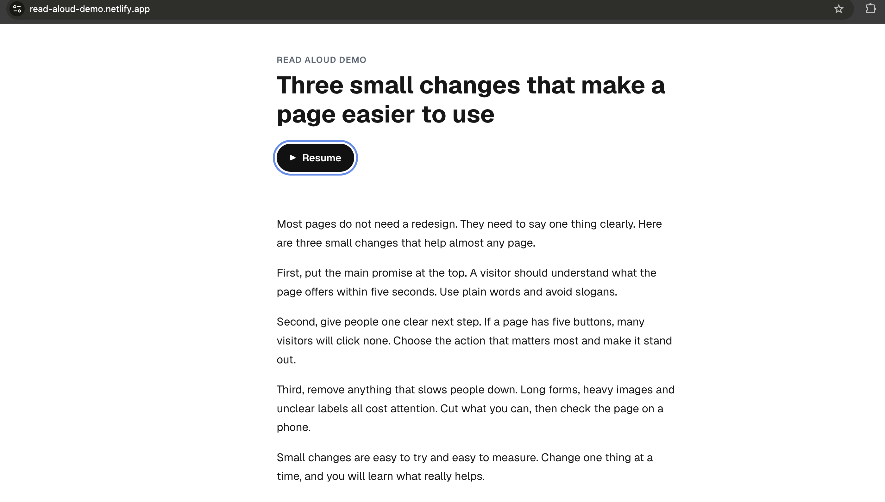
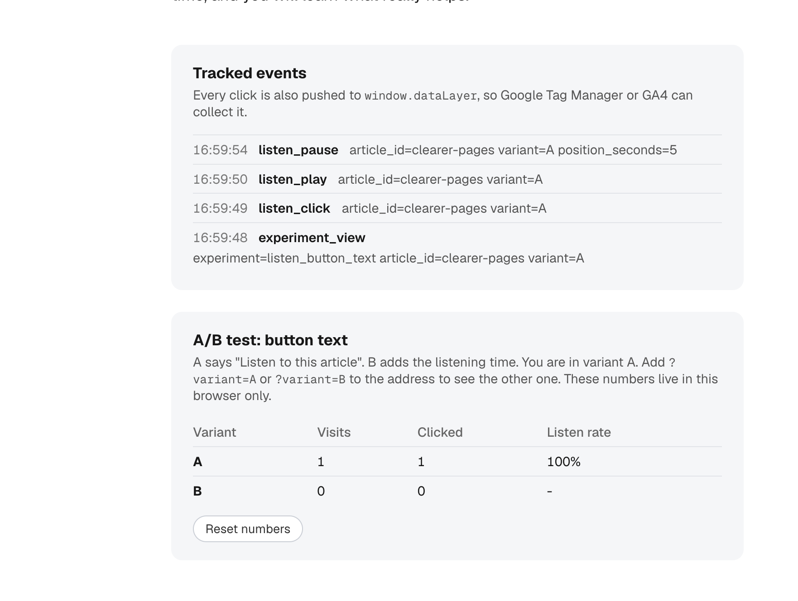

# Read Aloud

A small demo with a "Listen to this article" button. When you press it, the page reads the article out loud using the ElevenLabs text-to-speech API.

I wanted to build this the way a growth team would think about a new feature. It should work, I should be able to measure it, and it should be safe to leave on a public site. So the button tracks events, and I also run a small A/B test on the button text.

Stack is Next.js, React and TypeScript.

Live demo https://read-aloud-demo.netlify.app/





## How it works

The browser sends only an article id to `/api/speech`. The server finds the article text, asks ElevenLabs for the audio and sends it back. The API key stays on the server and never reaches the browser.

I did it this way for two reasons. If the browser could send any text, anyone could use my endpoint to voice whatever they want and spend my credits. With an article id, the server only speaks the articles I wrote in `src/content/articles.ts`. Also, the audio for an article never changes, so the server makes it once and keeps it in memory. I added a simple rate limit per IP too.

The button has five states. They are idle, loading, playing, paused and error.

## Events

Every action pushes an event to `window.dataLayer`, so Google Tag Manager or GA4 can read it. You can also see them live in the "Tracked events" box on the page.

| Event | When it happens |
| --- | --- |
| `experiment_view` | a visitor sees one of the button variants |
| `listen_click` | the visitor presses the button for the first time |
| `listen_play` | the audio starts |
| `listen_pause` | the visitor pauses (with the position in seconds) |
| `listen_resume` | the visitor continues after a pause |
| `listen_complete` | the audio reaches the end |
| `listen_error` | something fails (with a short reason) |

At the start, pressing Resume sent another `listen_click`. That made one person look like three clicks and the listen rate was too high. Now Resume has its own event.

The time between `listen_click` and `listen_play` is also useful. It shows how long people wait for the audio.

## A/B test

The question is simple. Do more people press the button if it shows the listening time?

- Variant A says "Listen to this article".
- Variant B says "Listen, 1 min". The minutes come from the article length.

I wrote a small feature flag for this in `src/lib/experiment.ts`. It picks A or B at random and saves the choice in the browser, so the same visitor always sees the same button. To test a variant yourself, add `?variant=A` or `?variant=B` to the address. Every event has a `variant` field, so you can split the results by group later.

The table under the events counts only in your own browser, so it is just a demo of the flow and not a real result. For a real test you need to send the events to GA4 or a tool like GrowthBook, and wait for enough visitors before you pick a winner.

## Run it

You need Node 22.

```bash
npm install
cp .env.example .env.local
npm run dev
```

Put your ElevenLabs API key in `.env.local`, then open http://localhost:3000 and press the button.

## Settings

| Variable | Required | What it does |
| --- | --- | --- |
| `ELEVENLABS_API_KEY` | yes | your ElevenLabs API key |
| `ELEVENLABS_VOICE_ID` | no | the voice to use, there is a default one |
| `ELEVENLABS_MODEL_ID` | no | the model to use, default is `eleven_multilingual_v2` |

If you make a key for this project, give it access to Text to Speech only and set a credit limit.

## Known limits

The audio cache and the rate limit live in the server memory. On a serverless host every instance has its own memory, so the audio can be made again after a pause and the limit is weaker. For a real product I would use Redis or a CDN.

The first click on a new article takes a few seconds, because the audio is made on demand. After that it starts almost at once.

## What I would do next

- Send the events to GA4 through Google Tag Manager.
- Add more articles and a voice picker.
- Make the audio when the site is built, so nobody waits.
